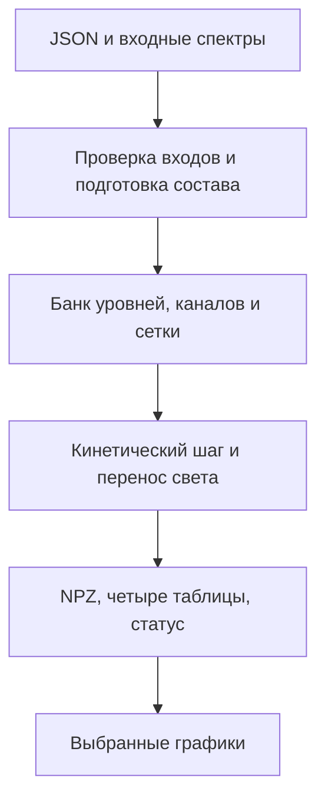

# Устройство программы

## Точки входа

`run.py --gui` открывает `launcher`; обычный `run.py --config ...` вызывает `mixture_kinetics.main`; `run.py data ...` — `data_import`; `run.py plot ...` — чтение сохранённых результатов; `run.py test` — unittest discovery с шаблоном `tests_*.py`.

## Поток данных

| Модуль | Ответственность |
|---|---|
| `grid_validation` | Общие структурные ограничения сеток, без научных зависимостей |
| `experiment_config`, `light_input`, `energy_input`, `spectrum_input` | Состав, нормировка частиц/света, преобразование пользовательских единиц |
| `atomic_database`, `prepare_species`, `mixture_data` | Подготовка/чтение атомных наборов, глобальная энергетическая шкала, ID |
| `mixture_kinetics.MixtureSlab` | Сборка и связанная эволюция; физические формулы описаны отдельно |
| `particle_kinetics.PhaseGrid` | Фазовые сетки, моменты, проекция, перенос и BGK |
| `kinetic_kernels`, `chemistry_kernels` | Numba-ядра парных событий и продуктов |
| `mixture_chemistry` | Декларативная химическая сеть, выбор σ/k и областей применения |
| `mixture_photo`, `slab_transport`, `slab_transport_fast` | Фото-сечения и перенос света |
| `collision_cache`, `collision_evolution` | Кэш геометрии и положительный столкновительный шаг |
| `spatial_sources`, `wall_boundaries` | Независимые источники и две поверхности слоя |
| `level_selection`, `atomic_core.Network` | Выбор базиса, стехиометрия, экспонента и балансы сети |
| `result_store`, `result_plots`, `result_browser` | Сохранение, расчёт выбранных графиков и окно результата |
| `reaction_catalog`, `reaction_selector`, `reaction_reference`, `process_map` | Выбор реагентов/реакций, ссылки на данные и текущий код |

## Массивы и соглашения

В модели `F[cell,E,mu]` — электроны, `P[cell,state,E,mu]` — тяжёлые частицы; `n=P.sum((2,3))`. Имена в NPZ отличаются: `electrons_cm3`, `heavy_cm3`, `n_cm3`, с первым измерением времени. Состояния описаны в `metadata_json.states`, реакции — в `metadata_json.reactions`. ID стабильнее номера столбца.

`F`/`P` содержат уже взвешенные числа узлов. Для плотности вероятности по энергии сначала суммируют μ, затем делят на полную концентрацию и `energy_weights_eV`. Не умножайте готовые узлы повторно на веса. Сетка тяжёлых энергий общая, скорости зависят от собственной массы каждого носителя.

Частота на один исходный уровень, коэффициент k и объёмная скорость R — разные величины. `MixtureSlab.rates` возвращает частоты, `snapshot.events` — скорости событий, `integral` — накопленные события. Стехиометрическая матрица связывает события с изменением каждой населённости.

## Работа с файлами

Пути из JSON разрешаются от папки конфигурации, а не текущего каталога shell. Поэтому `configs/*.json` используют `../data/...`. При копировании JSON в другую папку нужны согласованные относительные или абсолютные пути. Новые текстовые файлы записываются как UTF-8; читатели поддерживают BOM там, где это предусмотрено.

Подготовка элементов может обращаться в сеть; расчёты с подготовленными `data/elements` и `offline=true` работают локально. Импорт кандидатов из публикаций/UMIST не означает автоматического научного утверждения механизма. Научные таблицы и их исходные лицензии отделены от кэшей.

## Параллелизм и воспроизводимость

`performance.workers` управляет потоками Numba в отдельных ядрах. Это не независимый процесс на каждый атом и не GPU. BLAS-потоки ограничиваются на связанных шагах, чтобы не умножать вложенный параллелизм. Сначала проверяют результат с одним worker, затем измеряют ускорение.

Версия хранится в `VERSION.txt`; `project_version.VERSION` используется окном и экспортами. Источники и контрольные суммы данных сохраняются в метаданных. Схема входа `MixtureKineticSlab-2.1` не обязана совпадать с номером выпуска приложения.
