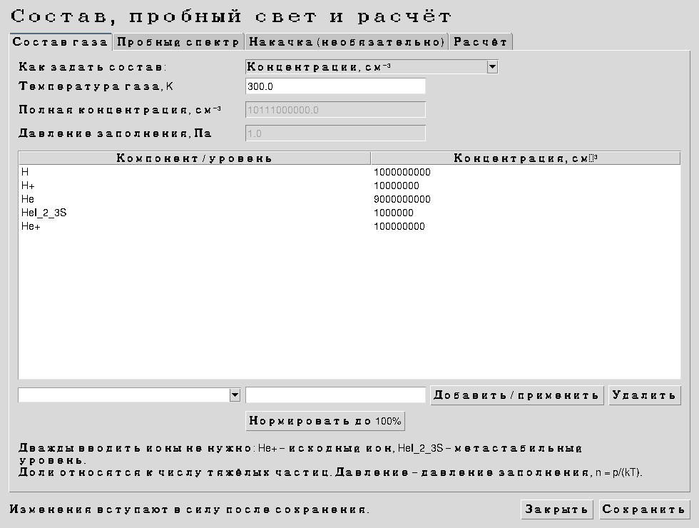
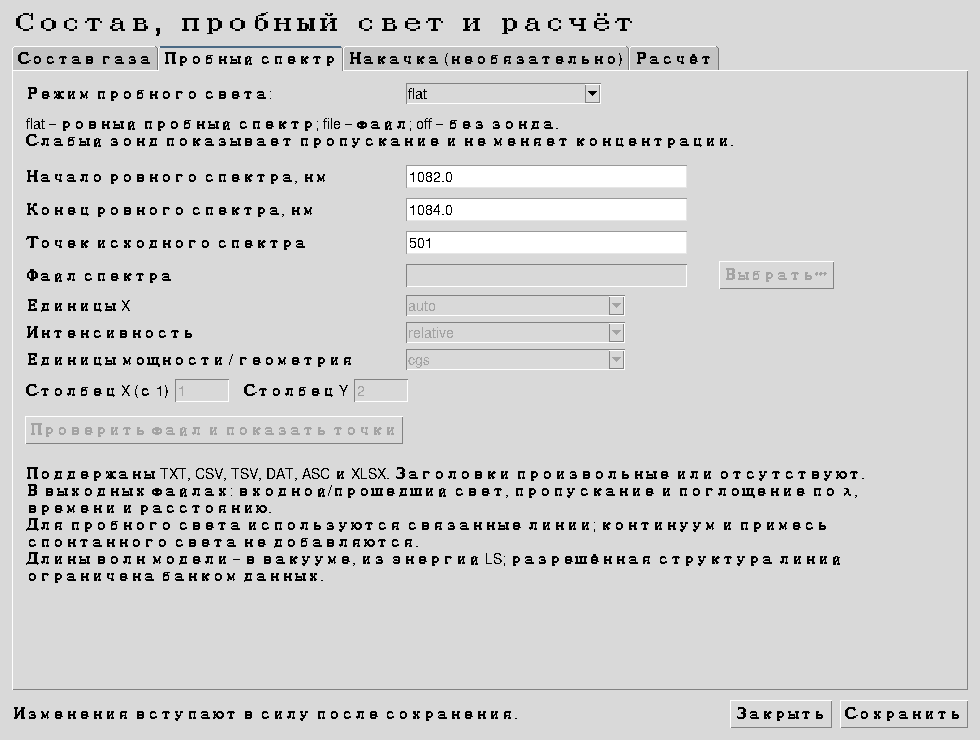

# Ввод состава и спектра в версии 2.5

Откройте `START_WINDOWS.bat`, оставьте пример `configs/gas_probe.json` и нажмите **Состав и спектр**. Для H–He–Li есть отдельный обычный пример `configs/gas_probe_H_He_Li.json`.

## Состав газа



| Режим | Что вводить |
|---|---|
| Концентрации | Отдельная начальная концентрация каждого компонента, см⁻³ |
| Доли и концентрация | Доли в процентах и общая концентрация тяжёлых частиц, см⁻³ |
| Доли и давление | Доли в процентах, температура газа, K, давление заполнения, Па |

В режимах долей сумма должна быть 100%. Кнопка **Нормировать до 100%** делит введённые значения на их сумму. Давление заполнения пересчитывается как `n = p/(k_B T)` для тяжёлых частиц; электронное давление в него не включается.

В таблице можно указать `H`, `H+`, `He`, `He+`, `Li`, `Li+`, метастабильный уровень `HeI_2_3S`, точный ID из банка или зарегистрированный молекулярный компонент. Выберите строку, измените число и нажмите **Добавить / применить**. Начатое редактирование также применяется при сохранении. **Удалить** исключает компонент. Нулевые строки не создают населённостей.

Список требуемых элементов и стадий теперь выводится из состава автоматически. После замены газа не остаются прежние концентрации другого элемента или ячеечные переопределения. Добавление имени элемента по-прежнему требует его физических данных: отсутствие сечений не заменяется сечениями другого атома.

Температура электронов и их начальная концентрация находятся на вкладке **Расчёт**. По умолчанию `n_e` вычисляется по начальному заряду ионов; можно задать её явно. Постоянная квазинейтральность в ходе расчёта этим не навязывается.

## Пробный спектр



Выберите `flat` для ровного зонда с заданным диапазоном, `file` для файла измерений или `off`. Зонд пассивный: его интенсивность не входит в скорости реакций и не меняет населённости. Выходной свет рассчитан как `I_out = I_in exp(-tau)` по текущим населённостям и профилям Фойгта, включая поправку на вынужденное излучение.

Это диагностика связанных линий в приближении слабого зонда. Континуальное поглощение и добавка спонтанного света в этот диагностический луч не включены. Полное собственное излучение модели по-прежнему записывается отдельно в `spectrum_final.csv`. Длины волн диагностических линий получены из импортированных энергий LS, в вакууме; точность тонкой структуры не заявляется.

Для файла достаточно двух числовых колонок. Названия колонок могут быть любыми; заголовок не обязателен. Можно выбрать номера колонок, начиная с 1. Поддержаны TXT, CSV, TSV, DAT, ASC и первый лист XLSX. Старый XLS надо предварительно сохранить как XLSX или текст.

Пример без заголовка, X в нм, Y в относительных отсчётах:

```text
1082.0  1.00
1083.0  1.02
1084.0  1.00
```

Русский CSV также принимается:

```text
Длина волны, нм;Отсчёты
1082,0;1,00
1083,0;1,02
1084,0;1,00
```

Распознаются UTF-8/BOM, UTF-16 и Windows-1251, пробелы, табуляции, `;` и CSV с запятыми. Убывающие координаты сортируются, повторные координаты объединяются с усреднением интенсивностей. Это отмечается в предпросмотре и квитанции импорта. Отрицательные относительные отсчёты сохраняются с пояснением; отрицательная физическая мощность отклоняется.

Единицы X: `auto`, `nm`, `A`, `um`, `eV`, `Hz`. В режиме `auto` используется узнаваемый заголовок, иначе выбираются нм и выдаётся пояснение. При неизвестных единицах выберите их явно. Для абсолютных спектральных плотностей применяется якобиан перевода, включая энергию и частоту. Относительные отсчёты не трактуются как абсолютная мощность.

Нажмите **Проверить файл и показать точки** до сохранения: будут показаны распознанный диапазон, единицы и первые 50 точек. Примеры находятся в `data/radiation/probe_example_nm.txt` и `probe_example_ru.csv`.

## Накачка и пространственные источники

Накачка находится на отдельной вкладке и исходно выключена. Она изменяет кинетику и требует абсолютной спектральной плотности:

| Выбор | Единицы входной колонки Y |
|---|---|
| `energy`, `cgs` | эрг / (см² с единица X) |
| `energy`, `W_m2` | Вт / (м² единица X) |
| `photons` | фотон / (см² с единица X) |
| `four_pi_J` | угловая величина 4πJ, прежняя договорённость модели |
| `normal_flux` | нормальный поток через плоскость; для направленного луча пересчитывается с учётом μ |

При X в нм плотность задаётся на нм, при X в эВ — на эВ и т. д. Старый CSV `wavelength_A;four_pi_J_lambda_erg_cm2_s_A` сохранён. У накачки есть начало и конец импульса; моменты переключения включаются в сетку времени точно. Выключенные источники и излучение с нулевым масштабом не требуют существования файла спектра.

Отдельная инжекция ионов и электронов, поток через источник и направленные пучки остались в **Дополнительно: Slab**. Их поток характеризует только явно включённую инжекцию и не нужен для задания исходного газа. Там же находятся обе стенки. Вероятности тушения задаются пользователем; универсальная вероятность для неизвестного материала не подставляется.

## Какие эффекты выключены в обычном режиме

В новом основном примере нет внешнего электрического поля, дрейфа тяжёлых частиц, углового перекоса электронов, горячей электронной добавки, источников частиц или включённой накачки. Оценочные сечения `allow_estimated_rates` и BGK-релаксация выключены. В обычном примере также выключены модельные упругие столкновения; их параметры доступны в JSON для осознанного выбора.

Сохраняются атомные электронные/фотонные процессы, спонтанное излучение, общие электроны и излучение, а также зарегистрированная химия. Для тепловых коэффициентов выбран явно обозначенный режим `maxwellian_moments`; он не равнозначен известному дифференциальному сечению. За опубликованный температурный диапазон коэффициенты не продолжаются. В `quality.json`, `data_gaps.csv` и `chemical_domain_audit.csv` перечислены исключённые или недоступные каналы.

## Выходные данные

| Файл | Содержание |
|---|---|
| `probe_transmission.png` | Входной/прошедший свет и процент поглощения |
| `probe_transmission.csv` | Финальные I_in, I_out, I_out/I_in, 1−I_out/I_in и τ по длине волны |
| `probe_history.csv` | Эти же характеристики во все сохранённые моменты времени |
| `probe_by_position_final.csv` | Пропускание и τ от входа до центров ячеек в конце расчёта |
| `probe_lines.csv` | Линии в полосе зонда, максимальная τ, эквивалентная ширина и источник данных |
| `probe_input_metadata.json` | Единицы, преобразования, SHA-256 файла и ограничения диагностики |
| `populations_by_cell.csv`, `spatial_profiles.csv` | Состав и концентрации по времени и расстоянию |
| `spatial_kinetics.csv` | Скорости и интегралы реакций по расстоянию |
| `strongest_lines_by_position.csv` | Ведущие линии собственного излучения и поглощения по ячейкам |

Программе не нужна точка в спектре ровно на центре линии: сетка зонда дополняется узлами профилей внутри входного диапазона. За пределами измеренного диапазона свет не достраивается.

## Воспроизводимая проверка

`python run.py test` запускает исходные регрессионные и новые входные/спектральные тесты. Для тестов настоящих окон Tk нужен графический дисплей; без него группа GUI пропускается с пояснением.

В этой сборке все 129 тестов выполнены с виртуальным X-дисплеем, без пропусков. Полностью выполнены H–He, H–He–Li и пример с численными долями и русским CSV; построены графики. Проверка касается работы кода, импорта, аналитических пределов и балансов. Она не доказывает полноту атомного банка или сходимость по всем сеткам. Нативный запуск Windows в данной среде не выполнялся.

Журналы и численные результаты проверок находятся в `validation/`. Код возврата 2 у примеров означает завершение с явно указанными ограничениями физических данных; расчёт и выходные файлы при этом созданы.
