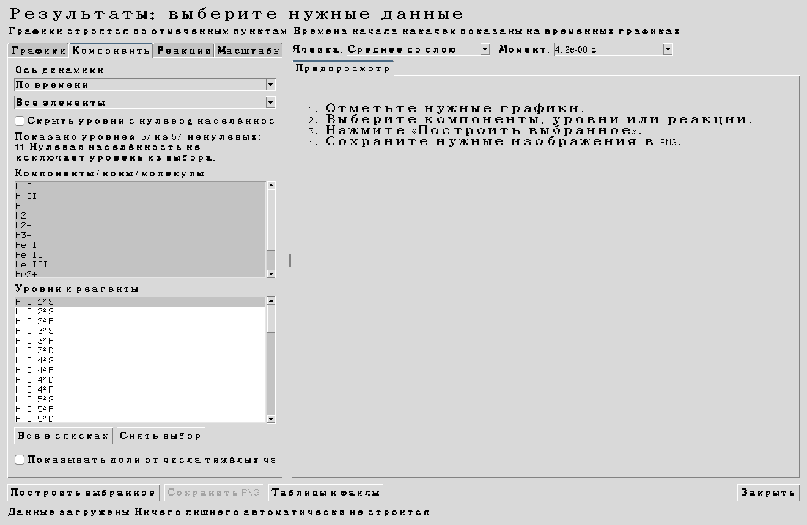
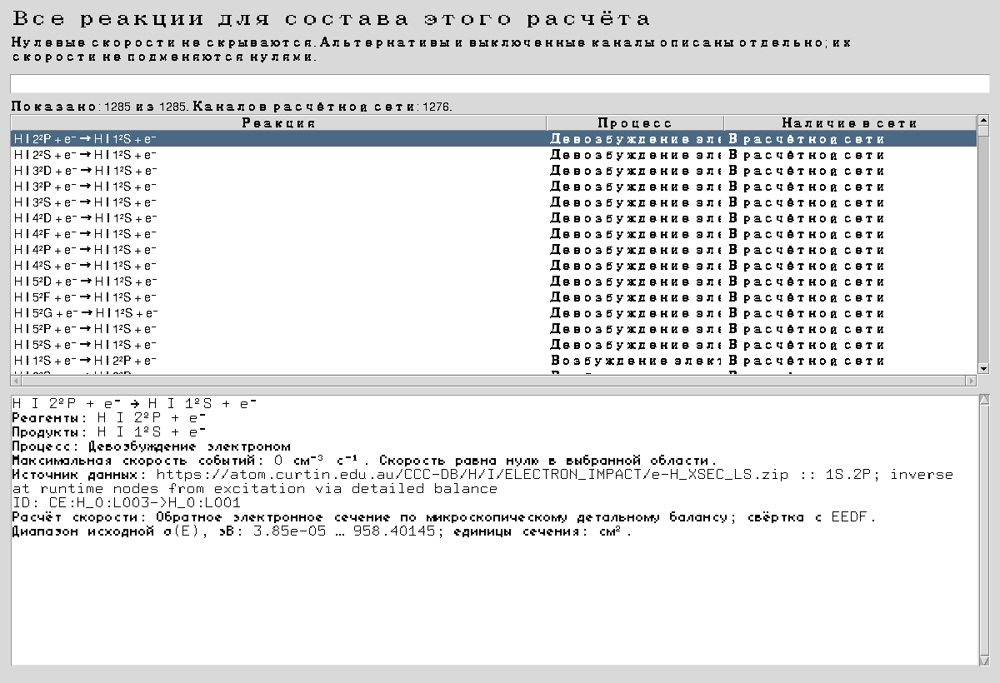
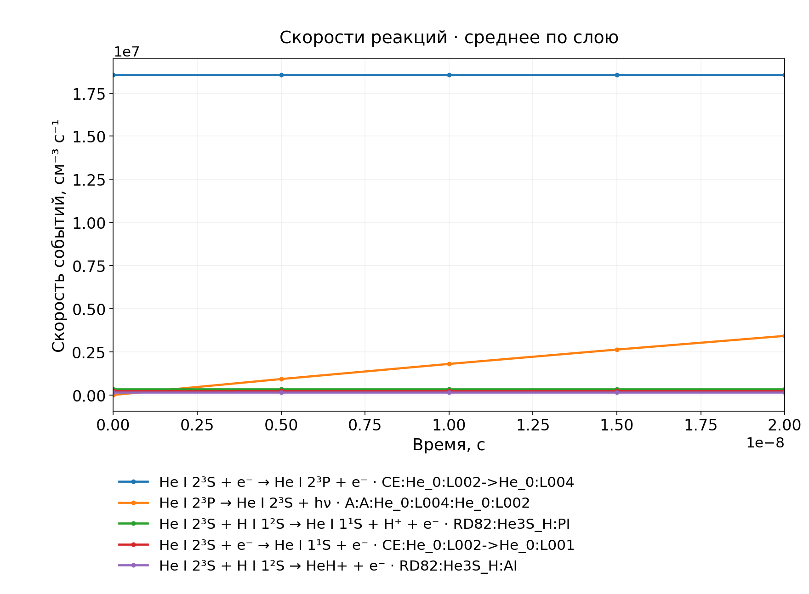
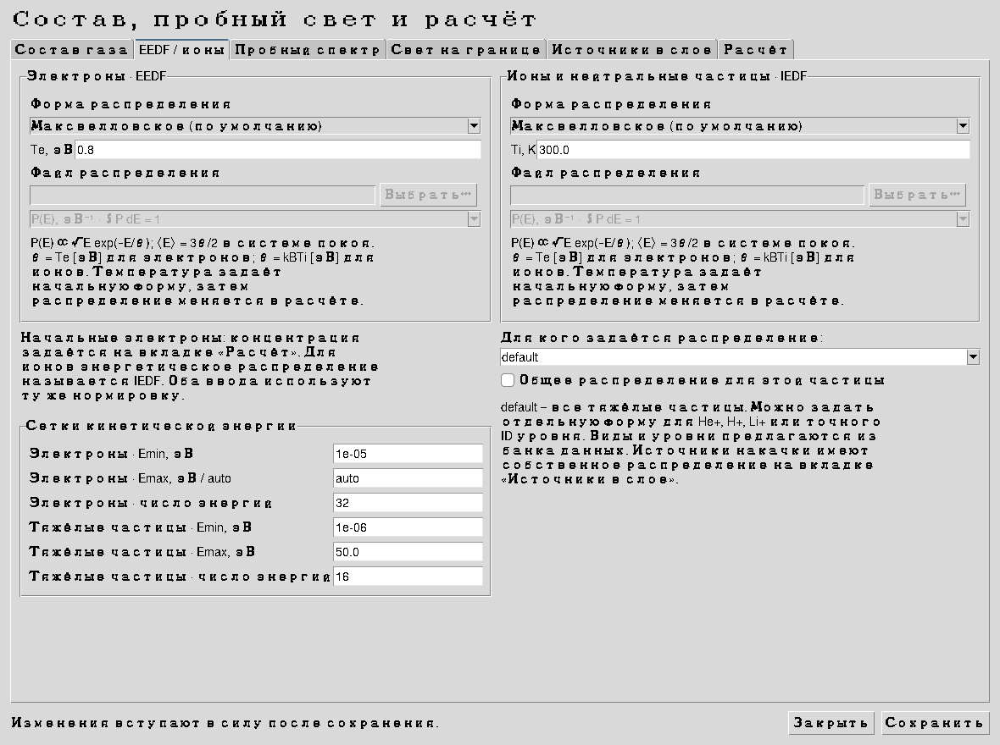

# Уровни, реакции, легенды и EEDF / IEDF · версия 2.8

## Почему списки были неполными

В списках компонентов по умолчанию скрывались состояния с нулевой населённостью. У холодного ненакáчанного гелия это оставляло только основное состояние, хотя в сохранённых данных были и другие уровни. Теперь фильтр выключен: доступны **все состояния сохранённой сети**, включая пустые уровни, ионы и молекулярные носители. Числа показанных и ненулевых состояний написаны над списками. Ввод состава и частиц источника также предлагает уровни из установленного банка, без фиксированного перечня из нескольких имён.

Состояния других элементов появляются в расчёте после их добавления в состав или источник. Наличие уровня в банке не означает, что для всех его столкновений известны сечения.

## Все реакции и происхождение данных

**Результаты → Реакции** показывает все каналы сохранённой сети. Оба списка реагентов содержат все её уровни; совместимые партнёры Б располагаются первыми. Если выбранная пара не имеет канала, выдаётся пояснение. Отдельный фильтр позволяет показывать только ненулевые скорости, но первоначально он выключен. **Сбросить фильтры** возвращает всю сеть.

При выборе нескольких строк внизу выводятся описания **всех выбранных реакций**. Кнопка **Все найденные** раскрывает описания всего отфильтрованного набора. У каждой записи есть ID, полные реагенты и продукты, тип процесса, источник и способ расчёта скорости. В новых результатах дополнительно сохраняются доступный диапазон σ(E), A, параметры и температурные интервалы k(T), метод получения, оценочный статус и ограничения исходной публикации.

**Справочник всех реакций** открывает таблицу всех численно обеспеченных каналов для состава расчёта, в том числе выключенных и альтернативных наборов. Есть поиск по участникам, ID, типу и источнику. В проверенном H–He примере справочник содержит **1285 записей**, а расчётная сеть — **1276 каналов**. Для не включённых каналов написано, что скорость не рассчитывалась. Их просмотр не меняет физические настройки.

Справочник строится программно из того же банка данных и стехиометрии, что и решатель. Он не ограничен примером He(2³S)+H. Атомные данные CCC/OPEN-ADAS, фото-сечения, химические реакции и тепловые коэффициенты сохраняют собственные ссылки. Полная библиография — [LITERATURE_RU.md](LITERATURE_RU.md), история источников — в существующих библиографических документах пакета. Отсутствующее сечение не заменяется похожим атомом или произвольной константой. Неподключённые физические каналы без численных данных остаются в перечне ограничений.

Старые NPZ из версий 2.6–2.7 открываются без пересчёта. Для них доступны все сохранённые реакции, источники и общие законы скорости; новые подробные поля коэффициентов и альтернативы появляются после нового расчёта.

## Легенды графиков

Легенда теперь привязана к области всего изображения, а её место рассчитывается по фактическим размерам текста. Названия не уходят за нижний край PNG. Цвета соответствуют кривым; у реакций добавлен уникальный ID, чтобы различать одинаковые уравнения из разных наборов. Нулевые кривые в логарифмическом масштабе остаются в легенде с пояснением об отсутствии положительных значений. Число кривых на изображении и размер шрифта регулируются на вкладке **Масштабы**.

## Где вводить EEDF и IEDF

Откройте **Параметры → EEDF / ионы**. Слева — начальное распределение электронов (EEDF), справа — ионов и нейтральных частиц (IEDF для ионов). Выбор `default` относится ко всем тяжёлым частицам; можно задать отдельную форму для компонента, стадии иона или точного ID уровня. Концентрации по-прежнему задаются в составе газа, а nₑ — на вкладке **Расчёт**. Энергия в файлах всегда задаётся в **эВ**, в том числе для ионов.

| Форма | Что вводится | Нормировка и углы |
|---|---|---|
| Максвелловское, по умолчанию | Te в эВ для электронов; Ti в K для ионов | P(E) ∝ √E exp(−E/θ), средняя энергия 3θ/2 в системе покоя. Начальный газ изотропен. Дискретные моменты согласуются с вводом. |
| Файл P(E) | Два столбца E [эВ], P [эВ⁻¹] | ∫P(E)dE=1; автоматическая нормировка. Начальное распределение изотропно, u_z=0. |
| Файл EEPF | Те же два столбца, явно выбранная EEPF [эВ⁻³ᐟ²] | P(E)=√E·EEPF(E), затем нормировка. Это другая конвенция; она не определяется догадкой по имени файла. |
| Фазовый CSV | `energy_eV;mu;probability_per_eV_mu` | Прямоугольная таблица E, μ; μ=cos угла к z. Интеграл по E и μ равен 1. Файл должен покрывать расчётную сетку. Позволяет задавать направленные частицы. |

Для двух столбцов поддержаны TXT, CSV, TSV, DAT, ASC, XLSX, произвольный заголовок, пробелы/табуляция/`;`/`,` и десятичная запятая в подходящем разделителе. Отрицательные значения, повтор энергии и пустая форма дают конкретную ошибку. Примеры аналитических форм: [электроны](../examples/electron_energy_pdf.csv), [ионы](../examples/ion_energy_pdf.csv). Это учебные входные распределения, не измеренные атомные коэффициенты.

Внизу этой вкладки задаются Emin, Emax и число узлов обеих энергетических сеток. Электронный Emax=`auto` учитывает диапазон энергетического файла. Вне покрытого диапазона форма не продолжается; если сетка не подходит, выдаётся сообщение о её границах. Перенос P(E) на сетку сохраняет число частиц и первый энергетический момент кусочно-линейной входной формы; фрагмент ниже Emin допускается только при относительном энергетическом дефекте не более 10⁻¹⁰.

На вкладке **Источники в слое** каждый электронный или ионный источник имеет собственную форму, температуру или фазовый файл. По умолчанию это максвелловский пучок. Его средняя скорость задаётся явно вместе с концентрацией; для фазового файла она проверяется на согласованность с u_z. Изотропная форма P(E) имеет u_z=0, поэтому для направленных источников предлагаются максвелловская форма и фазовый CSV. Независимые световые источники по-прежнему задаются нормированным пробным спектром и множителем мощности.

В **Результаты → Графики** доступны **Энергии электронов** и **Энергетические распределения ионов / атомов**. Для ионов/атомов предварительно выбираются уровни на вкладке **Компоненты**; распределения относятся к выбранной ячейке или среднему по слою и выбранному сохранённому моменту.

## Физический смысл и ограничения

Заданная форма является **начальным условием** или распределением частиц источника. Она не удерживается искусственно во времени: далее изменяется действующими кинетическими операторами. Максвелловское значение по умолчанию не означает, что реальная плазма всегда максвелловская. Реакции с доступным σ(E) используют текущее распределение; тепловые k(T) остаются явно обозначенным моментным замыканием. Коэффициенты из опубликованных интервалов не экстраполируются.

Ранее начальные 300 K на грубой сетке превращались в 295.556 K по моментам и исключали коэффициент с нижней границей 300 K. Согласование моментов теперь включено в новых пресетах и редакторе. В проверенном штатном H–He расчёте получены 300.000000000002 K и ненулевая скорость **3.5×10⁵ см⁻³ с⁻¹** для RD82:He3S_H:PI. Формула и исходные числа коэффициента не менялись.

Карта реализации со строками файлов: [PHYSICS_CODE_MAP_RU.md](PHYSICS_CODE_MAP_RU.md). Журнал проверок: `validation/tests_2_8.log`. Прохождение балансов не доказывает полноту научных данных или сходимость всех сеток.

## Источники определения распределений

1. G. J. M. Hagelaar. *Brief documentation of BOLSIG+ version 03/2016*. [Официальное руководство](https://www.bolsig.laplace.univ-tlse.fr/wp-content/uploads/2016/03/bolsigdoc0316.pdf), разделы «Rate coefficients» и «List of symbols». Использовано для явного различения конвенций f₀/EEPF и энергетической плотности вероятности. BOLSIG+ как внешняя программа в расчёте не запускается.
2. OpenMC. *openmc.stats.Maxwell*. [Официальная документация](https://docs.openmc.org/en/stable/pythonapi/generated/openmc.stats.Maxwell.html). Определение максвелловской энергетической плотности через √E exp(−E/θ). OpenMC в расчёте не используется.
