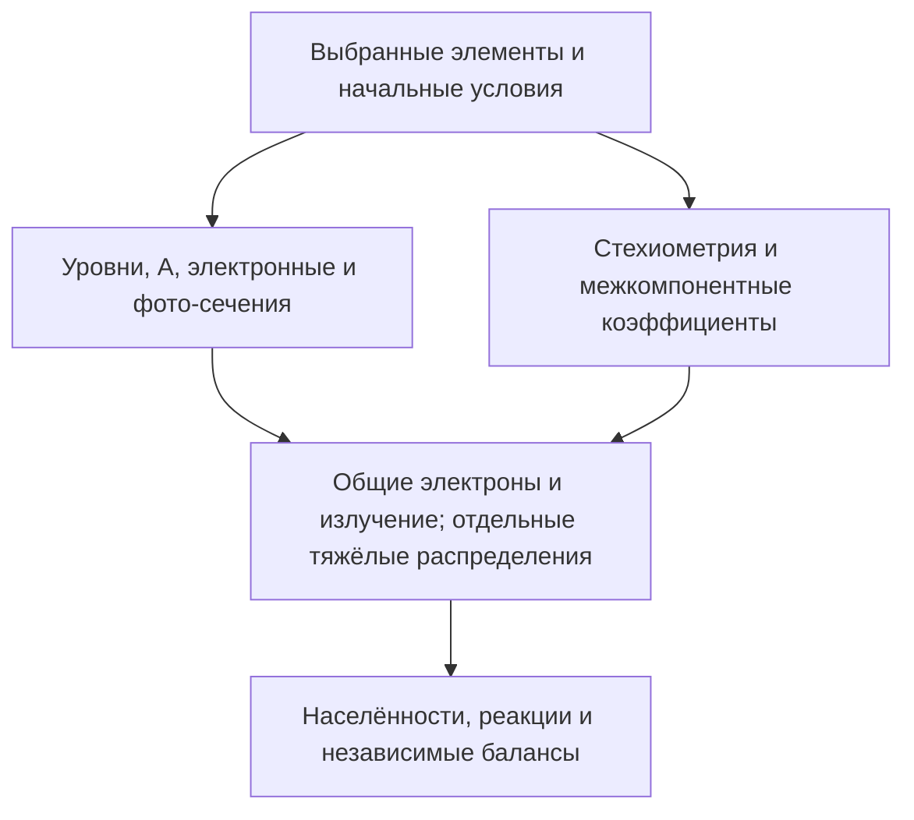

Дополнения 2.4: `SLAB_SOURCES_RU.md` (источники/стенки), `PROCESS_AUDIT_2_4_RU.md` (новые реакции и пределы применимости). Основные уравнения прежнего ядра ниже сохраняются.

# Модель 2.1: что действительно интегрируется

## Неизвестные и связь компонентов

В каждой ячейке слоя эволюционируют электронные узлы `F_e(E,μ)` и отдельные узлы `F_s(E,μ)` каждого включённого атомного/ионного уровня и эффективного молекулярного компонента. Узел содержит число частиц в см⁻³, а не значение непрерывной PDF. Плотность — сумма узлов. Все атомы, ионы и молекулярные носители используют общие электроны и одно поле излучения. Молекулярные носители имеют собственную массу: например, HeH⁺ не переносится как атом гелия.

Координата `μ` — косинус угла скорости к оси слоя. Состояния скалярные; выстраивания, J/M-матриц плотности, зеемановского перемешивания и спинового подавления Пеннинга здесь нет.

## Атомные процессы

Для подключённых таблиц работают электронное возбуждение/девозбуждение, ударная ионизация, спонтанные и стимулированные переходы, фотоионизация и рекомбинация через соотношение Милна. Накачка и каскады определяются уровнями и A, а не списком заранее рассчитанных ответов.

Для электронного удара частота вычисляется непосредственно по σ(E) и текущим электронным узлам. Электронная энергия меняется на энергию перехода. Maxwellian Υ(T) сохраняется отдельной таблицей и **не обращается в σ(E)**. Электронные неупругие столкновения сохраняют ограничения исходного ядра: неподвижная мишень, приближённые выходные углы, равное деление энергии при ионизации и отсутствие тяжёлого отдачного импульса в этих атомных каналах.

Для H/водородоподобных состояний фотосечения рассчитываются по кулоновским дипольным интегралам; для He I используются HS98; для остальных основных ионных состояний — доступные параметры Verner. Неизвестные фотосечения возбуждённых состояний Li/Na не заменяются гелиевыми.

## Два различных входа для химии

**Энергетическое сечение.** Для пары A,B рассчитывается относительная энергия в системе центра масс и интеграл

\[
R_{AB}=\int F_A F_B\,\sigma(E_{rel})v_{rel}\,d\Gamma_A d\Gamma_B.
\]

В коде это сумма по фазовым узлам и относительному азимуту. Такой вход действительно чувствителен к распределениям и встречным пучкам. Точки за пределами σ(E) не продолжаются автоматически; занятая неподдерживаемая область попадает в `data_gaps.csv`.

**Тепловой коэффициент.** Если опубликован только k(T), режим `chemistry.rate_policy="maxwellian_moments"` явно разрешает замыкание по относительной температуре моментов:

\[
T_{rel}=\mu_r\left(T_A/m_A+T_B/m_B\right)
 +\mu_r(u_A-u_B)^2/(3k_B).
\]

Здесь температуры выражены в K, μ_r — приведённая масса. Для немаксвелловских/анизотропных распределений это приближение. Оно сохраняет распределения частиц как неизвестные, но **не восстанавливает неизвестную зависимость вероятности реакции от относительной скорости**. Внутри допустимого интервала R=k(T_rel)n_A n_B. Для эндотермического процесса события допускаются только на энергетически доступных парах; нормировка сохраняет заданный тепловой коэффициент. Это тоже модельное замыкание, которое может потребовать очень малого шага при плохо разрешённом хвосте.

Отдельный двухтемпературный коэффициент рекомбинации He₂⁺ использует электронную температуру моментов и температуру молекулярных ионов. Их отношение не заменено фиксированным `Tg=300 K`.

`cross_sections_only` запрещает использовать k(T) вместо энергетических сечений. В этом режиме неподключённые тепловые каналы перечисляются как пробелы, включая Пеннинг, если для него в выбранном наборе есть только k(T).

## Пеннинг, ассоциация и химические продукты

Поддержан общий двухчастичный оператор `2 → 2` и `2 → 3`, с явными электронами и полной стехиометрией. Среди подключённых каналов:

- He(2³S)+H → He+H⁺+e и → HeH⁺+e;
- 2He(2³S) → He+He⁺+e и → He₂⁺+e;
- диссоциативная рекомбинация HeH⁺, H₂⁺, H₃⁺ и He₂⁺;
- реакции HeH⁺ с H/H₂, обмен H/H₂⁺ и взаимная нейтрализация с H⁻.

Каждая реакция проходит проверку сохранения **каждого элемента и заряда**, включая электрон. Для одинаковых реагентов коэффициент с соглашением `event_rate` задаёт R=k n² и сток реагента 2R. Для сечения используется число неупорядоченных пар: R=½⟨σv⟩n². Соглашение обязательно записано в данных.

Энергия Q вычисляется из единой шкалы состояний, не задаётся второй независимой константой. Энергии H₂/H₂⁺/H₃⁺/HeH⁺/He₂⁺ привязаны к атомным порогам и указанным энергиям связи. Образование молекулы не теряет её ядра из баланса.

Стоки селективны по входным фазовым узлам. Продукты формируются через координаты Якоби с сохранением энергии и векторного импульса отдельного события **до проекции на сетки**. Выходные углы изотропны: дифференциальные данные не выдумываются. При трёх продуктах Пеннинга электрону передаётся `min(Q, доступная относительная энергия)` в соответствующей координате Якоби, оставшаяся энергия остаётся относительному движению тяжёлой пары. Это приближение распределения энергии электрона, а не опубликованный электронный спектр. Для двух продуктов ассоциативной ионизации энергетика определяется двухчастичной кинематикой.

Положительная проекция сохраняет число и энергию внутри энергетической области. Вблизи полярной границы возможен дефект продольного импульса; он выводится отдельно. Столкновения не исправляют балансы последующей перенормировкой населённостей. Значимый выход продуктов за Emax останавливает расчёт с указанием требуемой сетки.

Для резонансной H⁺–H перезарядки используется отдельная модель прямолинейных траекторий: нейтрал получает скорость входного иона и наоборот. Популяционная стехиометрия равна нулю, а функции распределения меняются. Поэтому события этого процесса смотрите в `chemical_event_history.csv`, а не только в top-5 источников/стоков населённости.

## Шаг, базис и перенос

Сохранился перенос по слою, электрическое ускорение и существующие e–e/e–ion/нейтральные операторы. Различные элементы не заменяются гидродинамическими скоростями. Полной многокомпонентной Landau-модели нет.

За шаг последовательно выполняются перенос, существующие столкновительные операторы, атомные реакции/RR и новая химия. Химические частоты заморожены на своём подшаге. При слишком большом фазовом стоке шаг отклоняется и уменьшается. Порядок расщепления в общем случае первый: обязательна проверка уменьшением `max_step_s`, а не только уменьшением допуска балансов.

Все участники подключённых химических каналов сохраняются в рабочем базисе. Это предотвращает исчезновение, например, HeH⁺ из-за отбора только атомных переходов. Остальные уровни выбираются прежним алгоритмом посещений/каскадов; поток в исключённые известные уровни контролируется. `nmax=9` — предел чтения банка; он не создаёт отсутствующие высокие уровни. Верхняя граница источника и посещения последней оболочки выводятся отдельно.

Автоматическая электронная Emax учитывает также доступное энерговыделение подключённых хемиионизационных реакций. Пользовательская фиксированная Emax остаётся проверяемым ограничением.

## Пробелы, контроль и выходные файлы

`level_selection.missing_data="report"` позволяет исследовательский расчёт с явным списком пропусков; `"error"` останавливает его. `chemistry.coverage_policy` отдельно задаёт аналогичную политику для химии. За пределами k(T) канал **не экстраполируется**: пропуск остаётся в отчёте, а результат помечается неполным. Такой результат нельзя считать расчётом полного механизма.

Основные проверки: заряд, вектор ядер каждого элемента, масса в приближении ядерных масс, электронная+тяжёлая кинетическая+внутренняя энергия, фотонные события, соответствие изменения каждой населённости интегралу стехиометрических потоков и переносу. Свободная электронная масса и атомная масса используются в принятом нерелятивистском приближении; это не баланс масс покоя с дефектом массы E/c².

| Файл результата | Что смотреть |
|---|---|
| `quality.json` | Балансы, неполнота данных, применённые замыкания, число шагов |
| `states.csv` | Реальные ID, состав ядер, массы, энергии и активность состояний |
| `populations_by_cell.csv`, `particle_moments.csv` | Населённости и моменты распределений всех компонентов |
| `electron_phase_history.csv`, `heavy_phase_history.csv`, `mixture_history.npz` | Полные распределения |
| `reaction_catalogue.csv` | Все атомные и химические реакции с полными названиями |
| `chemical_reactions.csv` | Только подключённая химия, Q, вид коэффициента и источник |
| `chemical_event_history.csv` | Частоты и интегралы каждого химического канала во времени |
| `reaction_top5.csv`, `cell_*/reaction_dynamics/` | Лидирующие источники/стоки; постоянные столбцы и разрывы истории |
| `data_gaps.csv`, `chemical_domain_audit.csv` | Что пропущено; встретившиеся температуры, диапазоны и плотности пар |
| `pair_coverage.csv`, `chemical_known_omissions.csv` | Инвентаризация пар элементов и известные неподключённые механизмы |
| `conservation.csv`, `component_budgets.csv` | Независимые физические и кинетические остатки |
| `atomic_bank_provenance.json`, `chemical_data_provenance.json`, `run_metadata.json` | Источники и контрольные суммы фактически использованных данных/кода |

В `pair_coverage.csv` наличие одного канала означает `partial`, а не полноту всех столкновений всех уровней пары.
