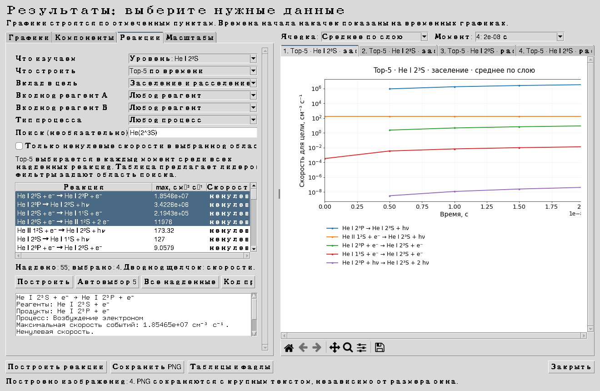

# Автоматический выбор реакций · 2.7

Откройте **Результаты → Реакции** и нажмите **Построить**: исходно предлагается top-5 для всей смеси. Переход на другую вкладку для включения галочек не требуется.

## Выбор без поиска названий и ID

1. **Что изучаем:** вся смесь, компонент, отдельный уровень или электроны. Список заполняется по состояниям сохранённого расчёта.
2. **Что строить:** top-5 по времени, скорости выбранных реакций или интегралы событий.
3. **Вклад в цель:** заселение, расселение, оба направления или участие. Для всей смеси показываются скорости событий. Для компонента исходно предлагается участие, чтобы внутрикомпонентное возбуждение оставалось видно; для уровня — оба направления изменения населённости.
4. **Входные реагенты А и Б:** любые участники либо конкретные компоненты, уровни, электроны и фотоны. После выбора А список Б сокращается до совместимых партнёров. Для реакции с двумя одинаковыми частицами проверяется коэффициент 2 в исходной стехиометрии.
5. **Тип процесса:** программа предлагает типы, присутствующие в подходящих каналах. Поиск вручную необязателен; поддержаны, например, H+, He*, He(2^3S), He I 2³S и русские обозначения электронов/фотонов.
6. Самые быстрые подходящие реакции выбираются автоматически. **Автовыбор 5** обновляет предложение; **Все найденные** выбирает весь набор. Ручной выбор сохраняется по ID при фильтрации. Двойной щелчок строит выбранные скорости.

Ячейка, момент и диапазон времени учитываются в предложениях. Top-5 считается по временному интервалу, а пространственные скорости — для выбранного момента. Цель и фильтры задают общий набор для top-5 и графиков реакций.

При режиме top-5 лидеры выбираются отдельно в каждый сохранённый момент среди всех найденных реакций. Табличное выделение предлагает кандидатов; оно не фиксирует одну пятёрку на всю историю. Поэтому объединение лидеров за всё время может занимать несколько изображений. Для двух направлений создаются отдельные графики заселения и расселения.

## Что видно сразу

В таблице показаны формула, максимум скорости событий и нулевой/ненулевой статус. Под таблицей — полные входные реагенты и продукты, название механизма, единицы скорости, источник данных и сохранённые ограничения применимости. Для новых расчётов 2.7 сохраняются также встречавшийся диапазон температуры k(T) и интервалы коэффициента.

**Код процесса** открывает внутри приложения соответствующие функции регистрации, вычисления скорости, изменения EEDF или химического ядра. Код показан с номерами строк, в режиме чтения. Ручной поиск файлов для просмотра выбранного оператора не нужен. Общая карта — [PHYSICS_CODE_MAP_RU.md](PHYSICS_CODE_MAP_RU.md).

Нулевая скорость, отсутствующий канал и выключенный процесс различаются. Нулевые каналы остаются в списке до явного включения фильтра ненулевых скоростей. При пустом наборе показана причина выбора и ограничения сохранённой сети; неизвестные коэффициенты при просмотре не подставляются.

## Почему 2.6 не выполняла нужный сценарий

В 2.6 данные о реагентах уже сохранялись, но интерфейс не использовал их как единый каталог:

- активная вкладка «Реакции» не меняла действие общей кнопки построения: исходно строились компоненты;
- цель относилась только к top-5, а текстовый поиск списка работал отдельно;
- нулевые скорости удалялись из списка без объяснения;
- поиск был буквальным: `He(2^3S)` не совпадало с подписью `He I 2³S`;
- после фильтрации автоподбор использовал глобальных лидеров, и подходящий канал вне глобальной пятёрки оставался невыбранным;
- не предлагались зависимые списки входных реагентов и единый способ выбора цели/процесса.

Это недоработка реализации интерфейса, а не ограничение физической модели. Прежние тесты проверяли заранее установленные галочки и готовый список, пропустив последовательность действий пользователя. В 2.7 добавлены проверки именно этой последовательности.

На реальном сохранённом H–He результате 2.6 воспроизведены: построение компонентов при открытой вкладке реакций; 0 совпадений для `He(2^3S)`; найденный PUMP-канал без выделения и ошибка «Выберите реакции». Исправленный просмотр нашёл 55 связанных каналов для метастабильного обозначения и построил отдельные группы заселения/расселения. Это число относится к этому сохранённому набору данных, а не является универсальным числом реакций гелия.

## Устройство изменения

- `reaction_catalog.py`: нормализация обозначений, состояния/партнёры, стехиометрия, фильтрация и ранжирование.
- `reaction_selector.py`: единая форма, зависимые списки, автоматический выбор и пояснения.
- `result_browser.py`: действие кнопки определяется текущей вкладкой; остальные графики сохраняют прежнее поведение.
- `result_plots.py`: top-5 учитывает выбранный набор каналов, оба направления и участие без изменения коэффициентов реакций.
- `process_map.py`: расположение функций и просмотр кода через AST, без исполнения показанного текста.

Формат результата 2.6 поддержан. Расчётная физика и численные коэффициенты не менялись; задача этой версии — правильный выбор и объяснение уже рассчитанных величин.

Для нового контрольного расчёта 2.7 также проверено объяснение нулевого канала `RD82:He3S_H:PI`: моментная температура 295.556 K при границах k(T) 300–4500 K. Заданная исходная температура газа — 300 K. Подробности чувствительности фазовой сетки приведены в карте физического кода; этот численный эффект не исправлялся изменением коэффициента или экстраполяцией в интерфейсе.
