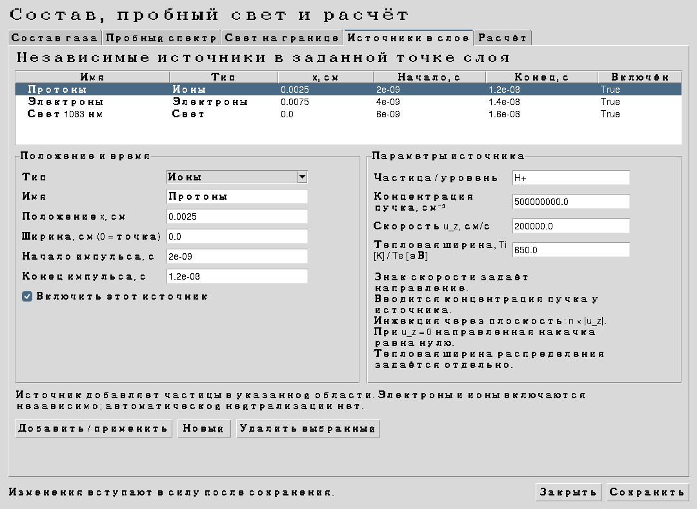
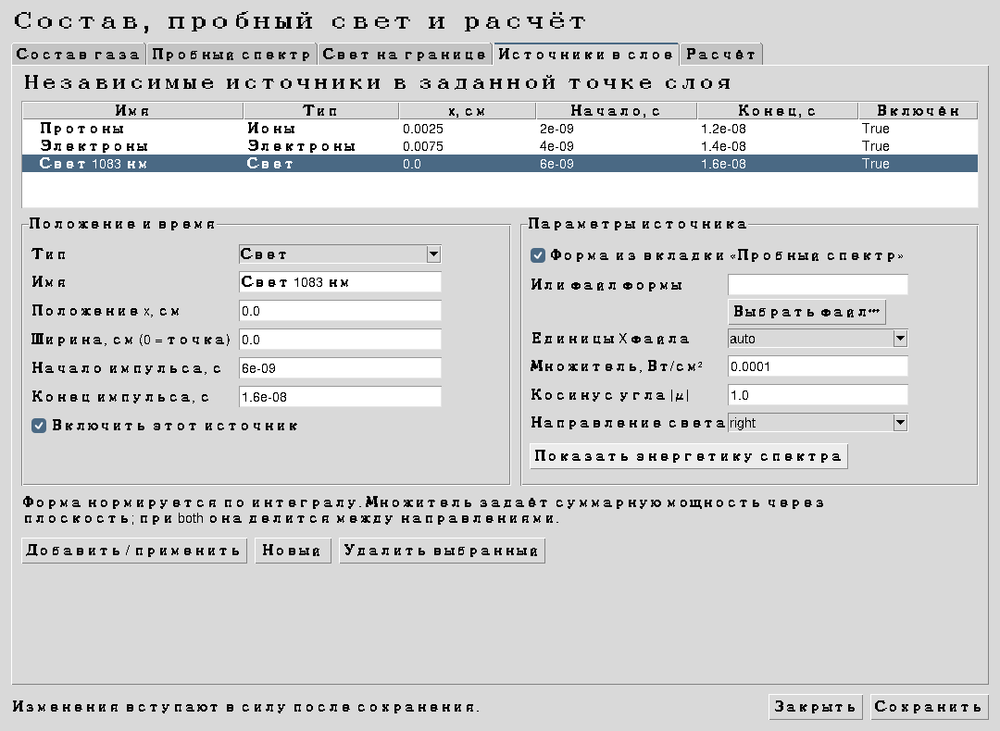
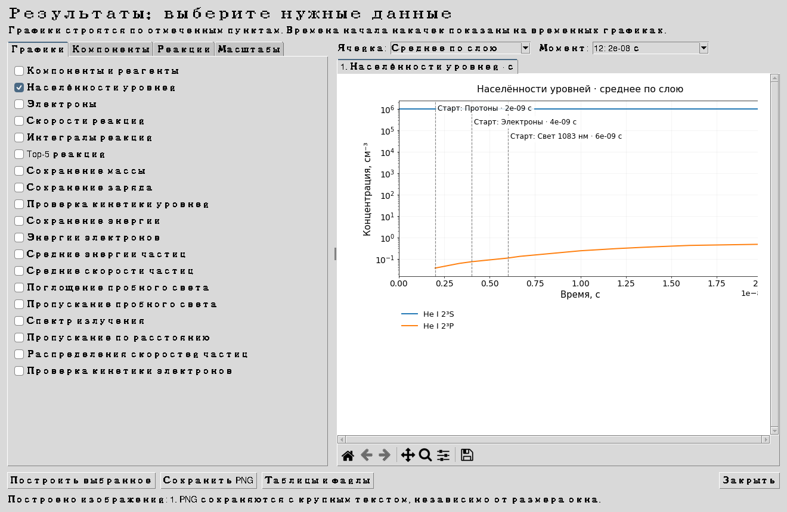
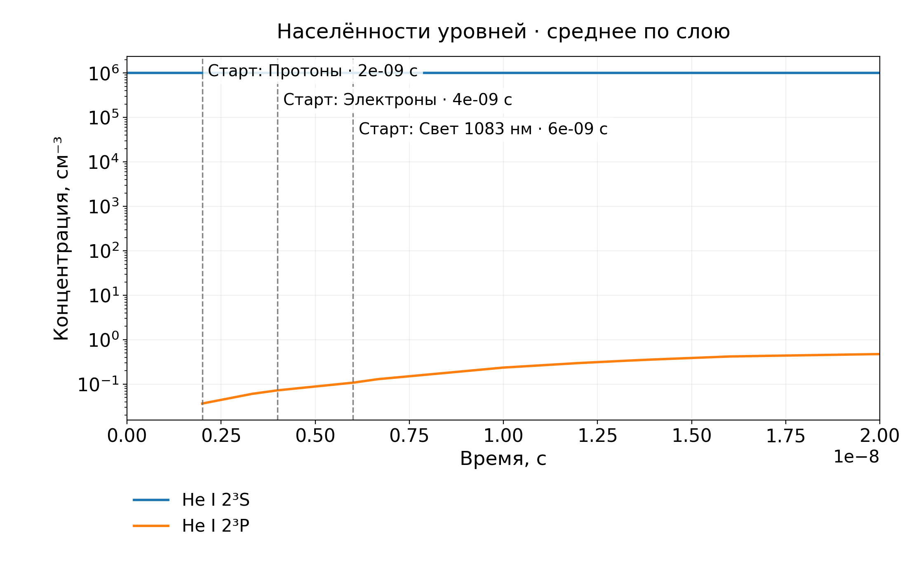

# Источники и выбранные результаты · 2.6

## Частицы: концентрация и скорость

Откройте **Состав и спектр → Источники в слое**. Каждый источник имеет имя, тип, флажок включения, положение, ширину и времена начала/конца. Нажмите **Новый**, задайте параметры, затем **Добавить / применить**. Начатое изменение также применяется при общем сохранении.

Для ионов выбираются вид или точный уровень, концентрация пучка в см⁻³, скорость u_z в см/с и температура в K. Для электронов температура задаётся в эВ. Положительная скорость направлена к увеличению x, отрицательная — к уменьшению x. Ионные и электронные источники независимы.

Определение концентрации: это концентрация пучка у плоскости источника. Число вводимых частиц на единицу площади в единицу времени вычисляется как **n |u_z|**; при u_z = 0 направленная инжекция равна нулю. В конечной ячейке ввод делится на её толщину. При постоянном импульсе полное число введённых частиц на единицу площади равно `n |u_z| (t_stop − t_start)`. Тепловая ширина распределения задаётся температурой. В дискретном распределении согласуются число частиц, средняя скорость и средняя кинетическая энергия.

Пример: n = 5·10⁸ см⁻³, u_z = 2·10⁵ см/с, импульс 10⁻⁸ с дают 10⁶ частиц/см². При попадании в ячейку толщиной 0.005 см добавка без последующих потерь составляет 2·10⁸ см⁻³. Исходный газ задаётся на отдельной вкладке **Состав газа**.

Для пространственного источника ширина 0 означает одну плоскость с внесением в содержащую её ячейку. Конечная ширина равномерно распределяет ввод по указанной области. Время переключения учитывается точно в сетке времени. Значения координат должны лежать внутри слоя.

## Свет: форма, множитель и энергия

Выберите тип **Свет** для источника в слое или вкладку **Свет на границе** для входного пучка. Формой служит пробный спектр либо отдельный файл. Достаточно двух колонок; поддержаны TXT, CSV, TSV, DAT, ASC и первый лист XLSX. Единицы X выбираются явно или определяются по заголовку: nm, A, um, eV, Hz. Для формы без заголовка в автоматическом режиме используются нм с пояснением.

Форма трактуется как спектральная энергетическая плотность, нормируется по интегралу до 1 и умножается на **полную мощность через плоскость, Вт/см²**. Поэтому изменение произвольного масштаба исходного файла не меняет результат при одном множителе. Для фотонной формы можно выбрать `photons` в настройках пробного файла и использовать эту форму для накачки. Переводы между координатами учитывают якобиан спектральной плотности. Отрицательная форма и нулевой интеграл отклоняются.

Кнопка **Показать энергетику спектра** выводит:

- минимальную, максимальную и среднюю энергию фотонов в эВ;
- нормальную мощность в Вт/см²;
- фотонный поток в см⁻² с⁻¹;
- для граничного источника — энергию импульса в Дж/см².

Энергия фотона определяется координатой спектра: E = hc/λ. Средняя энергия вычисляется по числу фотонов. Энергия прямоугольного светового импульса равна мощности, умноженной на его длительность. В результатах эти параметры также записываются в **О_результатах.txt** и доступны в окне графиков. Направление `both` делит заданную мощность между двумя лучами. Косинус μ учитывает наклон луча.

Пробная диагностика и действующая накачка сохраняют разные роли: первая вычисляет пропускание через рассчитанные населённости; вторая входит в скорости фотопроцессов. Форма у них может быть общей.

## Какие файлы создаёт расчёт

В папке результата находятся четыре CSV, один файл данных для графиков и краткое пояснение. Формат таблиц: UTF-8 с BOM, разделитель `;`, названия колонок по-русски.

| Таблица | Что искать |
|---|---|
| **сохранение.csv** | Относительные невязки массы, заряда, максимальной кинетической невязки и энергии по времени |
| **кинетика_уровней.csv** | Время, ячейка, расстояние, компонент, ID и название уровня, ядерный состав, заряд, концентрация и невязка кинетического уравнения |
| **реакции_по_времени.csv** | Все включённые реакции во все сохранённые моменты и ячейки: полный состав реагентов/продуктов, скорость событий, накопленный интеграл |
| **топ5_по_времени.csv** | Пять наиболее быстрых реакций, место, цель, заселение/расселение, доля от полного процесса цели и суммарное покрытие top-5 |

В таблице кинетики присутствуют все уровни и реагенты доступного расчётного банка, включая нулевые. Для смеси H–He–Li сохраняются состояния всех трёх элементов, их ионы и зарегистрированные молекулярные компоненты. Электроны имеют отдельные строки. Состав молекулы указан через числа ядер каждого элемента.

Невязка отдельного уровня вычисляется из изменения его населённости с вычитанием интеграла всех реакционных вкладов, переноса и внешнего ввода. Для электронов ведётся собственный баланс по ячейкам. Масса проверяется в принятом приближении ядерных масс. В подписанном CSV сохраняется знак невязки; на графиках проверок показывается её модуль.

Полные реагенты и продукты сохраняются даже при нулевом суммарном изменении некоторого вида. В частности, коэффициенты электронов в ионизации и рекомбинации не теряются.

## Выбор и сохранение графиков

1. Нажмите **Результаты**, затем на вкладке **Графики** отметьте интересующие величины.
2. Во вкладке **Компоненты** выберите виды и уровни. Фильтр элемента и флажок ненулевых видов сокращают список. Можно выделять несколько строк через Ctrl/Shift либо нажать **Все в списках**.
3. Для графиков реакций откройте **Реакции**: выберите конкретные реакции или цель top-5. Доступны вся смесь, любой компонент, отдельный уровень и электроны; для цели выбирается заселение или расселение.
4. Над предпросмотром задайте ячейку или среднее по слою и момент времени. Для пространственных профилей выберите ось **По расстоянию**.
5. Во вкладке **Масштабы** задайте размер текста, число кривых на изображении, пределы времени/спектра и типы осей. Нажмите **Построить выбранное**.
6. **Сохранить PNG** записывает только построенные изображения в выбранную папку, в подпапку `рисунки`. Можно дополнительно сохранить численные данные каждого графика в CSV. Повторное сохранение добавляет номер и сохраняет прежние изображения.

Доступны населённости, суммарные компоненты, электроны, скорости/интегралы реакций, top-5, проверки балансов, EEDF, средние энергии и скорости частиц, распределения скоростей, поглощение, пропускание, спектр выходящего света и пропускание по расстоянию. Населённости и скорости реакций можно строить по времени или по расстоянию. Для EEDF сравниваются начало и выбранный момент; для спектров используется выбранный момент.

**Top-5 меняется во времени.** Для каждой точки выбирается пятёрка из полного набора скоростей. Одна и та же реакция сохраняет свою кривую; вне пятёрки кривая прерывается. При дополнительном CSV эти места остаются пустыми. Для заселения/расселения учитываются стехиометрические коэффициенты. Доля реакции вычисляется от всех соответствующих процессов цели, а не только от лидеров.

## Читаемость, начало импульсов и log

По умолчанию размер основного текста — **16 pt**, экспорт — **200 dpi**, до пяти кривых на изображении. Большой выбор автоматически делится на несколько изображений с сохранением размера текста. Названия и единицы находятся на самом графике; для временного профиля указан выбор ячейки, для пространственного/спектрального — момент. Предпросмотр вписывается в окно, а размер экспортируемого PNG остаётся постоянным.

Начало каждого включённого ненулевого источника отмечается вертикальной линией и подписью на временном графике. На спектральных и пространственных графиках времена начала приводятся текстом над графиком. При log X и начале импульса t = 0 ставится подпись: ноль не переносится на ложную положительную координату.

Оси X и Y настраиваются независимо: линейная, логарифмическая или симметричная логарифмическая. Обычный log отображает положительные значения; симметричный log подходит для знаковых скоростей и величин, проходящих через ноль. Выбор масштаба меняет изображение, а исходные данные сохраняются полностью. При отсутствии подходящих значений выдаётся понятная подпись.

## Воспроизводимость

В сборке пройдены 155 тестов, включая реальные Tk-окна с виртуальным дисплеем, сохранение выбранных PNG, размеры текста, отметки импульсов, log-оси, top-5 с пропусками, конвертацию n и u в ввод частиц, согласование моментов источника и сохранение световой мощности при переходе на фотонную сетку. Выполнены три полных расчёта: H–He, H–He–Li и H–He с отдельными протонным, электронным и световым импульсами. Нативный Windows-запуск не выполнялся.

Известные ограничения базы и кинетических приближений перечислены в **О_результатах.txt** и в документации модели. Новые сечения или недоказанные физические механизмы при этих изменениях не добавлялись. Успешные балансы подтверждают согласованность реализации, а полнота физических данных и сходимость требуют самостоятельной проверки для выбранного режима.
